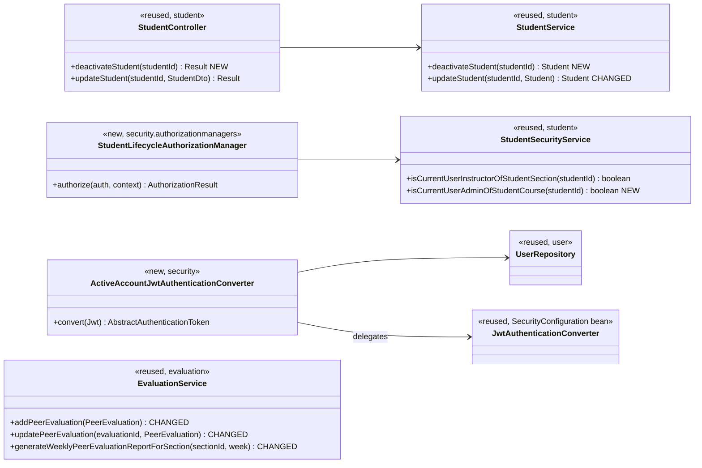
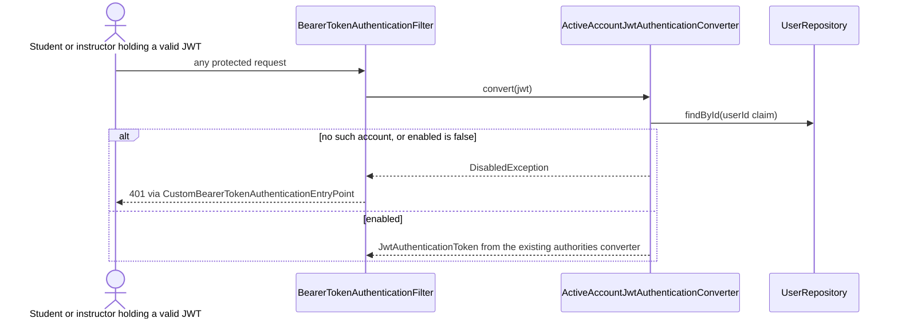

# Student (STU) Design

> Realizes: UC-STU-deactivate-student
> Depends on: FR-SEC-active-account, FR-SEC-deny-unauthorized; BR-student-lifecycle, BR-evaluation-active-evaluatee, BR-submission-owed, BR-section-scoped-access, BR-role-based-access
> See: [use cases](../requirements/use-cases.md#student), [business rules](../requirements/business-rules.md), [SRS security requirements](../requirements/software-requirements-specification.md#security-and-authorization-requirements), [architectural-design.md](architectural-design.md#shared-foundation-components) (foundation component view, Crosscutting Concepts → Security & Compliance)
> Designed against `main` at `59f0267` (2026-11-05).

## Overview

This area covers the student account lifecycle in the `student` feature slice of the REST API container. Deactivation is one flag, `PeerEvaluationUser.enabled`, that already existed and that login already honored (`MyUserPrincipal.isEnabled`). Before this design it was reachable only as a field of the generic student edit, which skipped the consequence warning of step 4, applied the wrong guard (the student herself could reach the route, and a course admin not assigned to the student's course section could not), and left three consequences unenforced: a session already open stayed valid until its JWT expired (2 h), teammates could still submit peer evaluations of her, and the course section's weekly peer evaluation report kept listing her. This design gives deactivation its own guarded endpoint and closes those three gaps where they live: the security filter chain, `EvaluationService`, and the report.

## Components & classes



- **Backend, `student/`:** [`StudentController`](../../backend/src/main/java/team/projectpulse/student/StudentController.java) and [`StudentService`](../../backend/src/main/java/team/projectpulse/student/StudentService.java) gain `deactivateStudent`; `updateStudent` stops copying `enabled` (a separate refactor commit). [`StudentSecurityService`](../../backend/src/main/java/team/projectpulse/student/StudentSecurityService.java) gains `isCurrentUserAdminOfStudentCourse`, fail-closed like its siblings (unknown id → `false`, never a throw). No new DTO: the response is the existing `StudentDto`.
- **Backend, `security/`:** new `authorizationmanagers/StudentLifecycleAuthorizationManager` (instructor of the student's course section **or** course admin of her course, ids read through `PathVariables`); new `ActiveAccountJwtAuthenticationConverter`, wired into `oauth2ResourceServer().jwt()` in [`SecurityConfiguration`](../../backend/src/main/java/team/projectpulse/security/SecurityConfiguration.java) around the existing `jwtAuthenticationConverter()` bean; one new route rule.
- **Backend, `evaluation/`:** [`EvaluationService`](../../backend/src/main/java/team/projectpulse/evaluation/EvaluationService.java) rejects a deactivated evaluatee on create and on update, and its section report filters students as in *Key decisions*. The existing [`SubmissionStatusService`](../../backend/src/main/java/team/projectpulse/notification/SubmissionStatusService.java) already excludes a deactivated student from what is owed (BR-submission-owed) and is unchanged.
- **Frontend:** `apis/student` gains `deactivateStudent(id)`; [`StudentPerformanceDashboard.vue`](../../frontend/src/pages/students/StudentPerformanceDashboard.vue) (the UC-STU-view-student page, opened from a row of `Students.vue`) shows the status tag and, only while the student is enabled, a **Deactivate** button that opens an `ElMessageBox.confirm` with the consequences; [`EditStudentForm.vue`](../../frontend/src/pages/students/EditStudentForm.vue) loses its Status field (refactor commit); [`SubmitTeamsEvaluations.vue`](../../frontend/src/pages/evaluations/SubmitTeamsEvaluations.vue) lists only teammates whose `enabled` is true.

## Sequence

### UC-STU-deactivate-student: main success scenario

```mermaid
sequenceDiagram
    actor I as Course admin / instructor
    participant SPA as StudentPerformanceDashboard.vue
    participant SEC as StudentLifecycleAuthorizationManager
    participant SC as StudentController
    participant SS as StudentService
    participant DB as StudentRepository
    I->>SPA: open the student (steps 1-2, UC-STU-view-student)
    SPA-->>I: details; Deactivate only if enabled, else "Deactivated" and no action (3a)
    I->>SPA: Deactivate (step 3)
    SPA-->>I: confirm dialog: consequences and warning (step 4)
    alt cancel (5a)
        SPA-->>I: dialog closes, no request sent
    else confirm (step 5)
        SPA->>SEC: PUT /students/{studentId}/deactivate
        SEC-->>SPA: 403 unless instructor of her course section or course admin of her course (3b)
        SEC->>SC: deactivateStudent(studentId)
        SC->>SS: deactivateStudent(studentId)
        SS->>DB: findById, 404 if absent (6a)
        SS-->>SC: 409 if already deactivated (3a, server guard)
        SS->>DB: enabled = false, save (team untouched)
        SC-->>SPA: 200, StudentDto
        SPA-->>I: "<first> <last> has been deactivated", status tag updates (step 6)
    end
```

### FR-SEC-active-account: the next request of a deactivated account



## API contract

| Endpoint or job | Caller (who may) | Request | Success | Errors, by extension |
|---|---|---|---|---|
| `PUT /students/{studentId}/deactivate` (new) | course admin of the student's course, or instructor assigned to her course section (BR-student-lifecycle) | `studentId` in the path; no body | 200, `Result` with the updated `StudentDto` (`enabled` false) | 403 actor not permitted (3b); 404 student not found (6a); 409 student already deactivated (3a) |
| `PUT /students/{studentId}` (changed) | unchanged | `enabled` in the body is ignored | unchanged | unchanged |
| every authenticated route (changed) | any account with a valid JWT | unchanged | unchanged while the account is enabled | 401 once the account is deactivated or gone (FR-SEC-active-account) |
| `POST /evaluations`, `PUT /evaluations/{evaluationId}` (changed) | student, unchanged | unchanged | unchanged | 400 when the evaluatee is deactivated (BR-evaluation-active-evaluatee) |
| `GET /evaluations/sections/{sectionId}/week/{week}` (changed) | unchanged | unchanged | a deactivated student is listed only for a week with peer evaluations of her | unchanged |

## Key decisions

- **A dedicated action endpoint, not the `enabled` field of `PUT /students/{studentId}`.** The generic route's guard (`UserOwnershipAuthorizationManager`) admits the student herself and omits the course admin who is not assigned to the course section, and a field toggle cannot return 409 for 3a. The toggle is removed from `updateStudent` and `EditStudentForm` so deactivation has one path that carries step 4's warning. Rejected: keeping both paths. Consequence, accepted: until UC-STU-reactivate-student is built there is no reactivation path (recorded in that use case).
- **Who may deactivate.** `StudentLifecycleAuthorizationManager` passes the instructor of the student's course section (`isCurrentUserInstructorOfStudentSection`) or the course admin of the course that owns that course section (`isCurrentUserAdminOfStudentCourse`). Rejected: reusing `UserOwnershipAuthorizationManager`, which also passes the student herself.
- **Enforce FR-SEC-active-account per request, in the JWT converter.** The converter reads the account by the `userId` claim and refuses it when it is disabled or absent, for students and instructors alike. Rejected: a shorter token lifetime (still leaves a window), a token-version claim (needs a column and a login on every reactivation), and a revocation list (state for a stateless API). Cost: one primary-key read per request, negligible at SCA-cohort-load scale. This is the architecture change recorded in Crosscutting Concepts → Security & Compliance.
- **Deactivation keeps her team and history** (BR-student-lifecycle). Rejected: removing her from her team, which would orphan team-scoped history from her and make reactivation a two-step operation.
- **Peer evaluations of a deactivated student are rejected on the server**, on create and update (BR-evaluation-active-evaluatee), and the form hides her. Rejected: hiding her only in the form, which a stale page or direct call bypasses.
- **The section report decides by evidence, not by a date.** `generateWeeklyPeerEvaluationReportForSection` keeps an enabled student on a team as today, and keeps a deactivated one only when the week has at least one peer evaluation of her (`PeerEvaluationRepository.findByWeekAndEvaluateeId`). Because BR-evaluation-active-evaluatee blocks evaluations after deactivation, that is exactly "weeks before her deactivation that have data". Rejected: a `deactivatedAt` column, a schema change that would also need backfilling for already-disabled accounts.
- **409 for an already deactivated student**, not an idempotent 200: 3a is a distinct outcome, and a 409 tells a stale page to reload. The UI never offers the action in that state.
- **No email to the student.** Step 6 informs only the actor; her next login attempt fails with the existing account-status 401.

## Data model

No delta. `peer_evaluation_user.enabled` already exists; see the SRS's Business Domain Model.

## Reuse & cross-cutting

- Route guards follow the two-enforcement-point pattern and fail-closed rule in Crosscutting Concepts (`PathVariables`, `AuthorizationDecision`).
- Errors use the existing `Result` envelope and handlers: `ObjectNotFoundException` → 404, `AccessDeniedException` → 403, `PeerEvaluationIllegalArgumentException` → 400; 409 uses `StatusCode.CONFLICT` with a new student-slice exception handled in `ExceptionHandlerAdvice`.
- What a student owes and who is reminded already follow BR-submission-owed in `notification` (see [not.md](not.md)); nothing there changes.

## Tests

| Use case, flow | Level | Asserts |
|---|---|---|
| Main: instructor of the student's course section deactivates | integration | 200, `enabled` false; her team, weekly activity reports, and peer evaluations are still present |
| Main: course admin of the course, not assigned to the course section, deactivates | integration | 200 |
| Main | unit (`StudentService`) | sets `enabled` false and saves; team unchanged |
| 3a already deactivated | unit + integration | 409; nothing saved |
| 3a in the UI | manual | the page shows Deactivated and no Deactivate button |
| 3b student (herself or another), or instructor of another course section | integration | 403; student unchanged |
| 5a cancel | manual | no request sent; student unchanged |
| 6a student not found | unit + integration | 404 |
| FR-SEC-active-account: deactivated student logs in | integration | 401 |
| FR-SEC-active-account: active user with a valid JWT calls a protected route | integration | 200 |
| FR-SEC-active-account: deactivated student with a JWT issued before deactivation | integration | 401 |
| FR-SEC-active-account: deactivated instructor with a JWT issued before deactivation | integration | 401 |
| BR-evaluation-active-evaluatee: teammate submits a peer evaluation of her | unit + integration | 400; nothing saved |
| Section report, a week with peer evaluations of her | unit | she is listed |
| Section report, a week after her deactivation | unit | she is not listed |
| Peer evaluation form | manual | `SubmitTeamsEvaluations` lists only active teammates |
| Refactor: `updateStudent` with `enabled` false | unit | `enabled` unchanged |

## Open questions / risks

- No reactivation path exists between this build and UC-STU-reactivate-student; accepted, and stated in that use case.
- The per-request lookup also applies to instructors, so UC-INS-deactivate-instructor gains its FR-SEC-active-account enforcement as a side effect; its own row stays as it is until it is designed.
